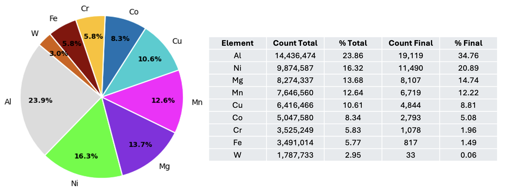
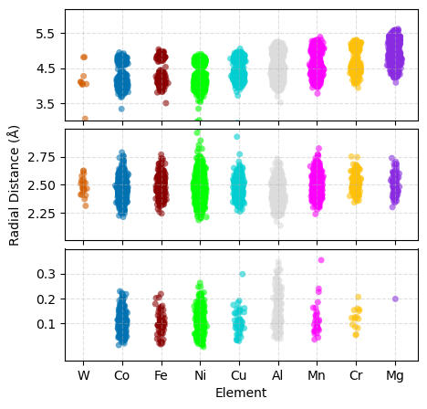
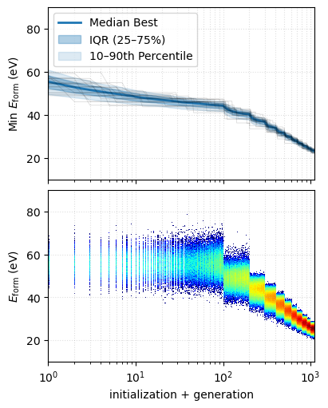

# Optimizing High-entropy Ratios for Formation Energy

<!-- Place figure6.png, figure7.png, and figure8.png alongside this Markdown file.
     Change the image paths below if your PNG filenames differ. -->

With the fine-tuned model preforming well, we now utilize it for another broad search. This time we use a Semi-grand Monte Carlo Evolutionary Search (SG-MCES): semi-grand because the number of atoms is fixed, but the composition is not - the algorithm is free to swap any atom with those available. The algorithm and data is available in full [HERE](https://github.com/anywallsocket/Professional-Projects/tree/main/FormationEnergy/CODE).

### Predictions for 5-element clusters (ranked by $E_{form}$):
1. Al0.4182Cu0.0364Mg0.0727Mn0.1273Ni0.3455
2. Al0.3636Cu0.0364Mg0.1455Mn0.1091Ni0.3455
3. Al0.4364Cu0.0909Mg0.1455Mn0.0545Ni0.2727
4. Al0.4727Co0.0182Mg0.1091Mn0.1091Ni0.2909
5. Al0.3818Cu0.0545Mg0.2364Mn0.1091Ni0.2182

The pseudo code is as such:

1. Initialize a population of randomly composed clusters.
2. Relax each cluster and score its formation energy.
3. Repeat for each generation:
   - Repeat until enough offspring are generated:
     - Select a parent, favoring lower formation energy.
     - Copy the parent.
     - Choose either atomic swaps or species transmutations.
     - Perform several trials using Metropolis acceptance.
     - Relax the resulting child and score its formation energy.
   - Combine parents and offspring.
   - Retain the candidates with the lowest formation energies.
4. Return the best candidate found.

To run:

1. Download the `CODE` directory, complete with `FT-2.model` (fine-tuned example model), or substitute with your own MACE model.
2. Run `python3 SG-MCES.py`.

**Figure 6.** SG-MCES hierarchy swaps Mg and Mn: **Al > Ni > Mg > Mn > Cu > Co > Cr > Fe > W.**

We run 1000 separate parallel jobs, for 55-atom clusters, each run for 1000 steps - including initial 100 steps, this totals to 1,100,000 images (60,500,000 total atoms). Of course it should be noted the early images per run are not as statistically relevant as the optimized images nearer the end. Hence [Figure 6](figure6.png) shows both the total percentages (over all 1,100,000 images) as well as over exclusively the final image per 1000 runs - i.e. which composition the cluster landed on after 1000 algorithmic loops.

**Figure 7.** Radial distance analysis. Given the 55-atom's icosahedral symmetry, three distance bands are naturally obtained even amid the algorithm's relaxation statistics. Here we show those three distance bands (relative to the center of the cluster) separately.

We can compare Figure 5's hierarchy with [Figure 7](figure7.png)'s, where it's noted that the SG-MCES swaps Ni and Fe, as well as Al and Mn, but is otherwise identical - this is despite these algorithms being structurally very different **W < Co < Ni < Fe < Cu < Mn < Al < Cr < Mg.**

Finally we look at the SG-MCES convergence.

**Figure 8.** Minimum formation energy (top) and its distribution (bottom), for the 1000 parallel runs, over their 100 initialization steps and subsequent 1000 generations. Color the histogram, where data density normalized over y-bins.

One thing to note here is that while it looks unconverged after 1000 generations, the x-scale is logarithmic, such that we may more closely examine long-term behavior. Those with the available compute should run SG-MCES until the step $E_{\mathrm{form}}(\mathrm{step})$ curve flattens.

## References

[0] [MACE](https://github.com/ACEsuit/mace/tree/100a29149d90a5945eddec1f0940bd88a6e3b363)

[1] [ASE-GA](https://dtu-energy.github.io/ase-ga/)
